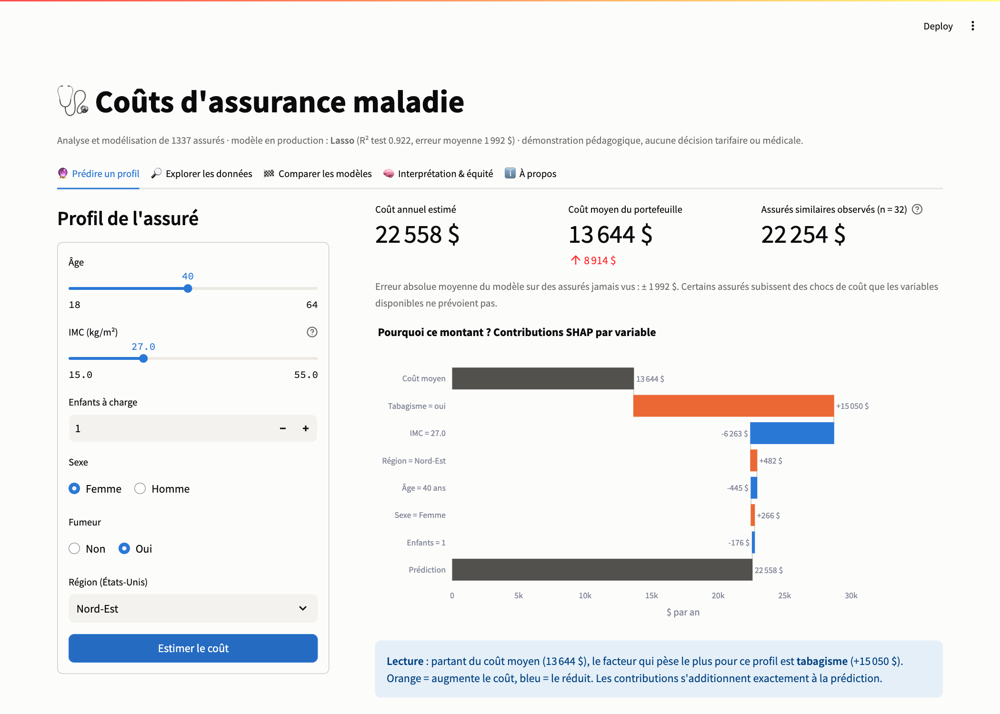
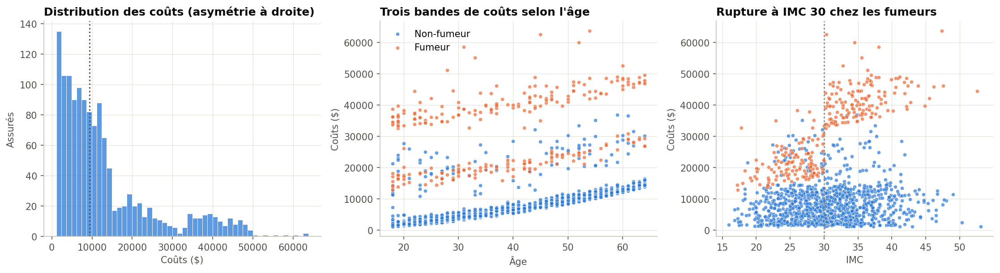
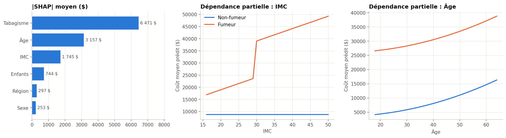

# Health Insurance Cost Analysis & Modelling

[](https://github.com/fleury-fcn/health-insurance-cost-analysis/actions/workflows/ci.yml)
[](https://fleury-fcn.github.io/health-insurance-cost-analysis/)
[](docs/10_deploiement.md)

[](https://github.com/astral-sh/ruff)
[](LICENSE)

🇫🇷 [Version française](README.md)

> **Which factors drive a policyholder's medical costs, and how can we predict them in a
> reliable, interpretable and fair way?** An end-to-end data science project with an
> actuarial lens: data audit, EDA, hypothesis testing, 8 benchmarked models, SHAP and a
> fairness audit. One command produces the model, the report and the demo.

📄 **[Full interactive report](https://fleury-fcn.github.io/health-insurance-cost-analysis/)** (in French)
· [PDF](https://fleury-fcn.github.io/health-insurance-cost-analysis/report.pdf)
· 🚀 **Streamlit demo**: [deployment guide](docs/10_deploiement.md)
· 📓 [Walkthrough notebook](notebooks/01_walkthrough.ipynb)



## Key results

| | |
|---|---|
| **Best model** | **Lasso** with domain interactions: test R² **0.922**, MAE **$1,992**, RMSE **$3,345** (baseline: $12,013) |
| **Top driver** | Smoking: mean cost **×3.8** ($32,050 vs $8,441), Hedges' g = 3.16 |
| **Key interaction** | Smoker **and** obese (BMI ≥ 30): $41,558/yr, vs $21,363 for non-obese smokers. BMI barely matters for non-smokers |
| **Linear ≈ boosting** | Lasso, Ridge, XGBoost, Random Forest and LightGBM are **statistically tied** (CV gaps ≈ $100 vs fold std ≈ $680). The simplest, auditable model is kept (2 KB) |
| **Risk ranking** | Normalised Gini **0.954** |
| **Fairness** | Errors are similar across sex and region. **Gender-neutral** pricing (mandatory in the EU) costs nothing (−$16 RMSE). Alert: 18-29 year-olds are over-predicted by 17% |
| **Main limitation** | 3.4% of policyholders experience cost shocks the 6 variables cannot explain (78% are non-smokers), so medical history data is missing |





## Methodology

| Phase | What | Why | Notes (FR) |
|-------|------|-----|------------|
| 1. Framing | problem, questions, success criteria | actuarial metrics (calibration, Gini) on top of RMSE/MAE | [01](docs/01_cadrage.md) |
| 2. Data quality | schema, types, duplicates, missing values, ranges, IQR/MAD outliers | extreme costs **kept**: 98% are smokers, i.e. the insured risk itself | [02](docs/02_qualite_donnees.md) |
| 3. EDA | uni/bi/multivariate, Pearson/Spearman, VIF | right skew (1.51) → log target / Gamma GLM tested | [03](docs/03_eda.md) |
| 4. Inference | Welch, Mann-Whitney, Kruskal-Wallis, Alexander-Govern, χ², bootstrap, partial F-tests, Holm | assumptions checked first (Shapiro, Levene); effect sizes and CIs throughout | [04](docs/04_inference.md) |
| 5. Features | obesity, smoker × obese/BMI/age, age²; Duan smearing | CV ablation: −27% RMSE; everything inside a sklearn pipeline (no leakage) | [05](docs/05_feature_engineering.md) |
| 6. Models | baseline, Ridge, Lasso, log target, **Gamma GLM**, RF, XGBoost, LightGBM | 5-fold CV tuning, **selection on CV not test**, bootstrap CIs | [06](docs/06_modelisation.md) |
| 7. Interpretation | exact SHAP, permutation, conditional PDP, subgroup fairness | SHAP on the 6 original variables, readable by business users | [07](docs/07_interpretation.md) |
| 8. Pipeline | Typer CLI, MLflow, run summary | seed 42, pinned deps, data checksum: **same results on every run** (up to float rounding) | [08](docs/08_pipeline.md) |
| 9. Report | Jinja2 → self-contained HTML + PDF, GitHub Pages | built only from artifacts, so it cannot contradict the model | [09](docs/09_rapport.md) |
| 10. Demo | Streamlit + FastAPI `/predict` (Swagger) | same SHAP function as the pipeline; bundled 2 KB model | [10](docs/10_deploiement.md) |
| 11. Quality | 48 pytest tests, GitHub Actions CI (lint, tests, pipeline, Docker) | CI runs the real pipeline end to end | — |

## Quick start

```bash
git clone https://github.com/fleury-fcn/health-insurance-cost-analysis.git
cd health-insurance-cost-analysis
python3.12 -m venv .venv && source .venv/bin/activate
make install-dev

make run      # data → quality → EDA → stats → models → SHAP → MLflow → report (~2 min)
make app      # Streamlit → http://localhost:8501
make api      # FastAPI   → http://127.0.0.1:8000/docs
make test
```

Docker: `docker build -t insurance-costs . && docker run -p 8501:8501 insurance-costs`.

## Limitations

Simulated data (1,338 rows, 6 features, no time dimension), associations not causation,
aggregated cost (no frequency/severity split), small test set (268), sensitive attributes
(sex is banned for EU pricing; BMI and smoking are health data under GDPR art. 9).

## Next steps

Medical history features · frequency × severity or Tweedie models on claims data · age
splines or per-band recalibration · prediction intervals (quantile/conformal) · drift and
calibration monitoring · causal study of smoking cessation.

## Data & license

*Medical Cost Personal Dataset* (B. Lantz; [Kaggle](https://www.kaggle.com/datasets/mirichoi0218/insurance),
**ODbL 1.0**). Code under the **MIT License** © Fleury Niyokwizera.
