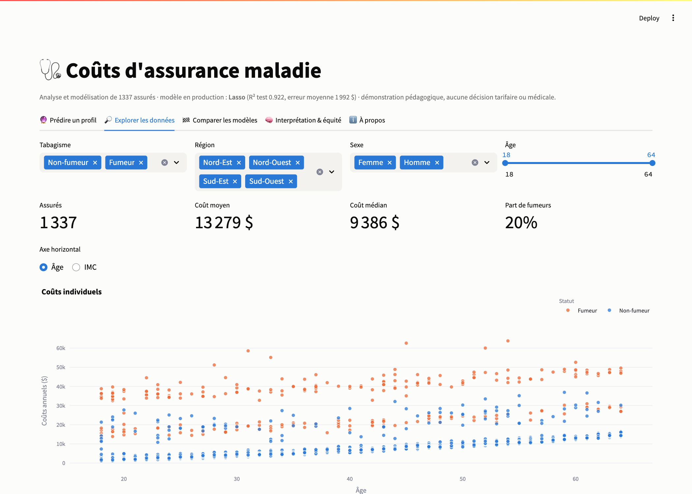
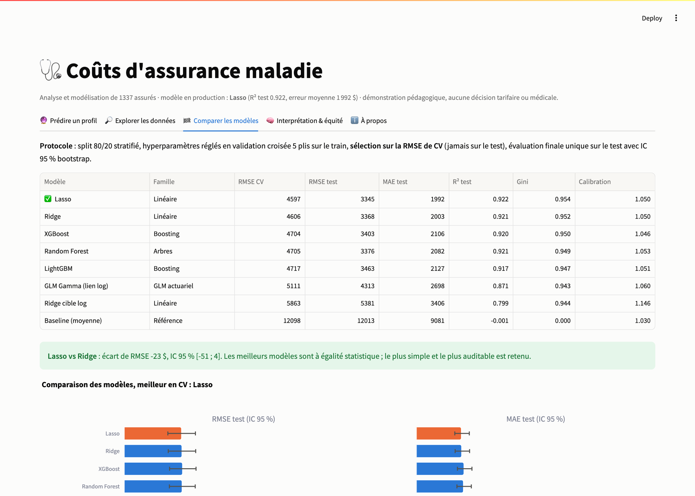
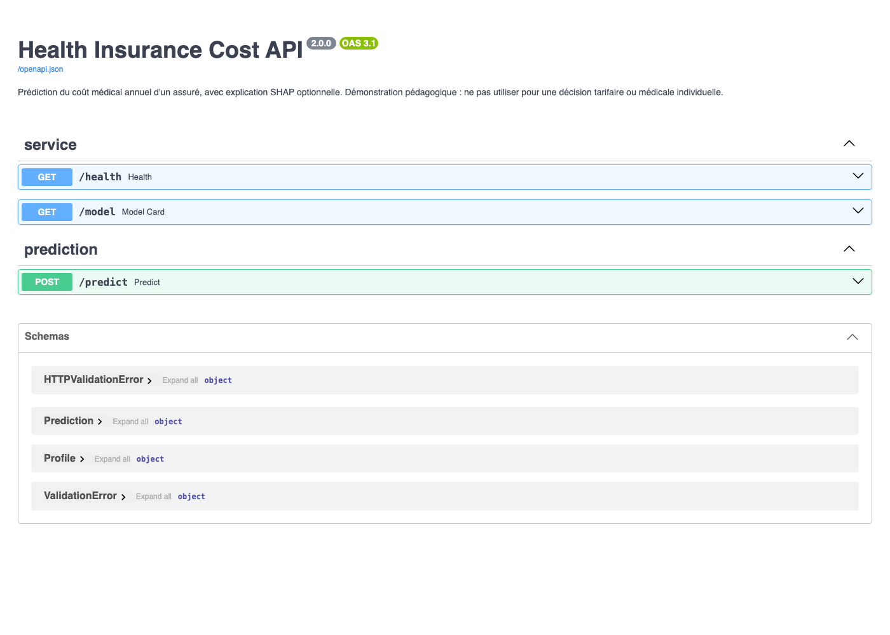

# Analyse et modélisation des coûts d'assurance maladie

[](https://github.com/fleury-fcn/health-insurance-cost-analysis/actions/workflows/ci.yml)
[](https://fleury-fcn.github.io/health-insurance-cost-analysis/)
[](docs/10_deploiement.md)

[](https://github.com/astral-sh/ruff)
[](LICENSE)

🇬🇧 [English version](README.en.md)

> **Quels facteurs expliquent les frais médicaux d'un assuré, et comment les prédire de façon
> fiable, interprétable et équitable ?** Projet de data science de bout en bout avec un regard
> actuariel : audit qualité, EDA, tests d'hypothèses, 8 modèles comparés, SHAP, audit
> d'équité. Une seule commande produit modèle, rapport et démo.

📄 **[Rapport complet (HTML interactif)](https://fleury-fcn.github.io/health-insurance-cost-analysis/)**
· [PDF](https://fleury-fcn.github.io/health-insurance-cost-analysis/report.pdf)
· 🚀 **Démo Streamlit** : [guide de déploiement](docs/10_deploiement.md)
· 📓 [Notebook de restitution](notebooks/01_walkthrough.ipynb)


## Résultats clés

| | |
|---|---|
| **Meilleur modèle** | **Lasso** avec interactions métier : R² test **0,922**, MAE **1 992 $**, RMSE **3 345 $** (baseline : 12 013 $) |
| **Facteur n°1** | Tabagisme : coût moyen **×3,8** (32 050 $ contre 8 441 $), g de Hedges = 3,16 |
| **Interaction clé** | Fumeur **et** obèse (IMC ≥ 30) : 41 558 $/an, contre 21 363 $ pour un fumeur non obèse. L'IMC ne change presque rien pour un non-fumeur |
| **Linéaire ≈ boosting** | Lasso, Ridge, XGBoost, Random Forest et LightGBM sont **à égalité statistique** (écarts de CV ≈ 100 $ pour un écart-type entre plis ≈ 680 $). Le plus simple et auditable est retenu (2 Ko) |
| **Segmentation** | Gini normalisé **0,954** : le modèle classe presque parfaitement les risques |
| **Équité** | Erreurs comparables selon le sexe et la région. Une tarification **unisexe** (obligatoire dans l'UE) ne coûte rien (−16 $ de RMSE). Alerte : les 18-29 ans sont surestimés de 17 % |
| **Limite principale** | 3,4 % des assurés subissent un « choc » de coût que les 6 variables n'expliquent pas (78 % sont des non-fumeurs) : il manque des données médicales |

<table>
<tr>
<td></td>
</tr>
<tr>
<td></td>
</tr>
<tr>
<td></td>
</tr>
</table>

## Méthodologie

| Phase | Ce qui est fait | Choix justifié | Doc |
|-------|-----------------|----------------|-----|
| 1. Cadrage | problématique, questions, critères de succès | métriques actuarielles (calibration, Gini) en plus de RMSE/MAE | [01](docs/01_cadrage.md) |
| 2. Qualité | audit schéma, types, doublons, manquants, bornes, outliers IQR/MAD | coûts extrêmes **conservés** : 98 % sont des fumeurs, c'est le risque assuré | [02](docs/02_qualite_donnees.md) |
| 3. EDA | univariée, bivariée, multivariée, Pearson/Spearman, VIF | asymétrie (skew 1,51) → cible log / GLM Gamma testés | [03](docs/03_eda.md) |
| 4. Inférence | Welch, Mann-Whitney, Kruskal-Wallis, Alexander-Govern, χ², bootstrap, F partiels, Holm | hypothèses vérifiées d'abord (Shapiro, Levene) ; tailles d'effet et IC systématiques | [04](docs/04_inference.md) |
| 5. Features | obésité, fumeur × obèse/IMC/âge, âge² ; smearing de Duan | ablation en CV : −27 % de RMSE ; tout dans un pipeline sklearn (pas de fuite) | [05](docs/05_feature_engineering.md) |
| 6. Modèles | baseline, Ridge, Lasso, cible log, **GLM Gamma**, RF, XGBoost, LightGBM | réglage en CV 5 plis, **sélection sur la CV et non sur le test**, IC bootstrap | [06](docs/06_modelisation.md) |
| 7. Interprétation | SHAP exact, permutation, PDP conditionnelle, équité par sous-groupe | SHAP sur les 6 variables d'origine, lisible par un métier | [07](docs/07_interpretation.md) |
| 8. Pipeline | CLI Typer, MLflow, résumé d'exécution | seed 42, dépendances figées, empreinte des données : **mêmes résultats à chaque run** (à l'arrondi machine près) | [08](docs/08_pipeline.md) |
| 9. Rapport | Jinja2 → HTML autonome + PDF, GitHub Pages | généré uniquement depuis les artefacts : ne peut pas contredire le modèle | [09](docs/09_rapport.md) |
| 10. Démo | Streamlit + FastAPI `/predict` (Swagger) | même fonction SHAP que le pipeline ; modèle de 2 Ko embarqué | [10](docs/10_deploiement.md) |
| 11. Qualité | 48 tests pytest, CI GitHub Actions (lint, tests, pipeline, Docker) | le CI exécute le pipeline réel de bout en bout | — |

## Démarrage rapide

```bash
git clone https://github.com/fleury-fcn/health-insurance-cost-analysis.git
cd health-insurance-cost-analysis
python3.12 -m venv .venv && source .venv/bin/activate
make install-dev        # dépendances figées + package

make run                # données → qualité → EDA → stats → modèles → SHAP → MLflow → rapport (~2 min)
make app                # démo Streamlit  → http://localhost:8501
make api                # API FastAPI     → http://127.0.0.1:8000/docs
make test               # 48 tests
make mlflow             # suivi des expériences → http://127.0.0.1:5000
```

Avec Docker :

```bash
docker build -t insurance-costs .
docker run -p 8501:8501 insurance-costs                                    # app
docker run -p 8000:8000 insurance-costs uvicorn app.api:app --host 0.0.0.0   # API
```

Exemple d'appel d'API :

```bash
curl -X POST "http://127.0.0.1:8000/predict?explain=true" -H "Content-Type: application/json" \
  -d '{"age":45,"sex":"male","bmi":32.5,"children":2,"smoker":"yes","region":"southeast"}'
# → {"predicted_charges": 41422.02, "contributions": {"smoker": 22070.42, "bmi": 4489.15, ...}}
```

## Captures

| Explorer les données | Comparer les modèles | API (Swagger) |
|---|---|---|
|  |  |  |

## Structure

```
├── src/insurance_costs/   package : data, eda, inference, features, modeling,
│                          interpretation, tracking, report, pipeline, cli
├── app/                   streamlit_app.py, api.py, requirements.txt (déploiement)
├── data/                  raw/ (téléchargé, vérifié SHA-256) · processed/ (versionné)
├── artifacts/             JSON de résultats + figures (Plotly JSON, PNG)
├── models/                best_model.joblib (2 Ko) + model_card.json
├── reports/generated/     report.html + report.pdf (publiés sur Pages)
├── notebooks/             visite guidée exécutée
├── docs/                  une note méthodologique par phase
└── tests/                 48 tests (données, stats, features, modèles, SHAP, CLI, API, app)
```

## Limites

- **Données simulées** (1 338 assurés, 6 variables), sans dimension temporelle, exposition ni
  franchise. Les montants ne se transposent pas à un portefeuille réel.
- **Associations, pas causalité** : le modèle ne dit pas ce qu'un individu économiserait en
  arrêtant de fumer.
- **Coût total agrégé**, sans séparation fréquence/sévérité.
- **Test de 268 assurés** : les conclusions d'équité sont des alertes à confirmer.
- **Données sensibles** : le sexe est interdit en tarification dans l'UE ; IMC et tabagisme
  sont des données de santé (RGPD art. 9).

## Pistes d'amélioration

1. Ajouter des variables médicales (antécédents, pathologies chroniques) pour expliquer les chocs.
2. Modèle **fréquence × sévérité** (Poisson × Gamma) ou **Tweedie** sur des données de sinistres.
3. Âge en spline ou recalibrage par tranche, pour corriger la surestimation des 18-29 ans.
4. **Intervalles de prédiction** (régression quantile, conformal prediction).
5. Monitoring de dérive et de calibration en production ; registre de modèles MLflow.
6. Étude causale de l'effet du sevrage tabagique (données longitudinales).

## Données et licence

*Medical Cost Personal Dataset* (B. Lantz, *Machine Learning with R* ; diffusion
[Kaggle](https://www.kaggle.com/datasets/mirichoi0218/insurance), licence **ODbL 1.0**). Voir
[data/README.md](data/README.md). Code sous **licence MIT** © Fleury Niyokwizera.
