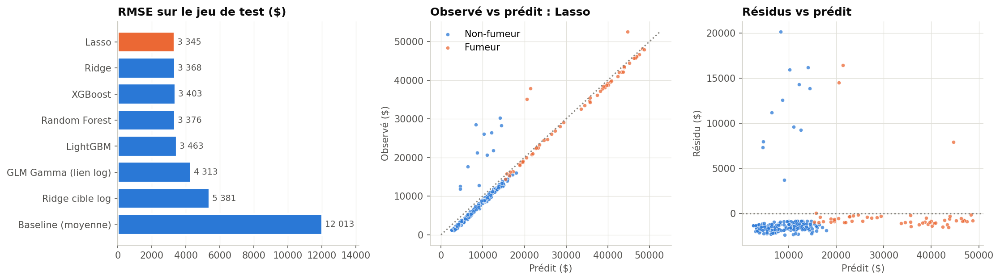

# Phase 6 — Modélisation

Script : [`src/insurance_costs/modeling.py`](../src/insurance_costs/modeling.py). Résultats :
`artifacts/metrics.json`, modèle : `models/best_model.joblib` + `models/model_card.json`.

## Protocole

1. **Split fixe 80/20 stratifié** sur le tabagisme : 1 069 lignes d'entraînement, 268 de test.
2. **Réglage des hyperparamètres en CV 5 plis sur le train** : grille logarithmique pour les
   modèles linéaires et le GLM, `RandomizedSearchCV` (30 tirages) pour les arbres.
3. **Sélection sur la RMSE de CV**, jamais sur le test. Choisir sur le test reviendrait à
   l'utiliser pour l'apprentissage, et la performance annoncée serait optimiste.
4. **Évaluation unique sur le test**, avec IC 95 % bootstrap (2 000 tirages) et un bootstrap
   apparié pour comparer les deux premiers modèles.

| Modèle | Rôle | Préparation |
|--------|------|-------------|
| Baseline (moyenne) | plancher | — |
| Ridge, Lasso | linéaires pénalisés (L2 / L1) | interactions + one-hot + standardisation |
| Ridge cible log | test de l'échelle multiplicative | idem + smearing de Duan |
| GLM Gamma lien log | **référence actuarielle** | idem |
| Random Forest, XGBoost, LightGBM | non-linéaires | variables brutes, encodage ordinal (les arbres apprennent seuls les interactions) |

## Métriques

- **RMSE** (critère de sélection) : pénalise les grosses erreurs, coûteuses pour un assureur.
- **MAE** : erreur typique en dollars, robuste aux extrêmes.
- **R²** : part de variance expliquée.
- **Déviance Gamma** : la métrique naturelle d'un GLM Gamma, qui pèse les erreurs en relatif.
- **Ratio de calibration** Σ prédit / Σ observé : un tarif doit équilibrer le portefeuille.
- **Gini normalisé** : capacité à **classer** les risques (1 = ordre parfait), critère de
  segmentation tarifaire.

## Résultats (jeu de test, n = 268)

| Modèle | RMSE CV (± é.-t.) | RMSE test | MAE test | R² test | Gini | Calibration |
|--------|------------------:|----------:|---------:|--------:|-----:|------------:|
| **Lasso** ✅ | **4 597 ± 684** | **3 345** | **1 992** | **0,922** | 0,954 | 1,050 |
| Ridge | 4 606 ± 681 | 3 368 | 2 003 | 0,921 | 0,952 | 1,050 |
| XGBoost | 4 704 ± 677 | 3 403 | 2 106 | 0,920 | 0,950 | 1,046 |
| Random Forest | 4 705 ± 659 | 3 376 | 2 082 | 0,921 | 0,949 | 1,053 |
| LightGBM | 4 717 ± 629 | 3 463 | 2 127 | 0,917 | 0,947 | 1,051 |
| GLM Gamma (log) | 5 111 ± 537 | 4 313 | 2 698 | 0,871 | 0,943 | 1,060 |
| Ridge cible log | 5 863 ± 415 | 5 381 | 3 406 | 0,799 | 0,944 | 1,146 |
| Baseline | 12 098 | 12 013 | 9 081 | 0,000 | 0 | 1,030 |

*Le test est plus facile que la CV (RMSE 3 345 contre 4 597) : il contient moins de cas
extrêmes. C'est la variance d'échantillonnage, que les IC bootstrap rendent visible.*

## Lecture

1. **Ex æquo statistique entre les 5 meilleurs.** Leurs écarts de RMSE CV (≈ 120 $) sont
   très inférieurs à l'écart-type entre plis (≈ 680 $). Le bootstrap apparié Lasso − Ridge
   donne −23 $ avec un IC 95 % de [−51 ; +4]. Le **Lasso** est retenu car il est premier en
   CV, et surtout **le plus simple, transparent et léger** (2 Ko, coefficients auditables).
2. **Le feature engineering métier vaut le boosting.** Avec les interactions tabagisme ×
   obésité/IMC/âge, un modèle linéaire atteint le niveau de XGBoost. Les arbres trouvent ces
   interactions seuls, sans les recevoir.
3. **GLM Gamma** : le moins bon des modèles « sérieux » car son lien log impose une
   structure multiplicative, alors que les données sont additives (bandes parallèles, cf.
   phase 5). Il reste la meilleure lecture tarifaire, avec des relativités exp(β) :
   tabagisme ×4,2 (à variables standardisées), `age_smoker` 0,66 (pente relative de l'âge
   plus faible chez les fumeurs), régions sud ×0,82 à 0,87. Sur des données réelles de
   sinistres, souvent multiplicatives, il serait probablement plus compétitif.
4. **Calibration** : tous les modèles surestiment le total du test d'environ 5 %, baseline
   comprise (+3 %). La moyenne du test est un peu plus basse que celle du train : c'est un
   effet d'échantillon, pas un biais du modèle. En production, un recalage du niveau
   global serait fait sur le portefeuille courant.

## Analyse des résidus (Lasso)

- **Structure en deux régimes** : 96 % des assurés sont dans une bande serrée de résidus
  autour de −1 400 $ (médiane), et 3,4 % ont un résidu supérieur à +10 000 $. Les coûts
  ressemblent à « coût de base + choc occasionnel » (hospitalisation, pathologie non
  observée).
- **Ce n'est pas un défaut**, c'est la mutualisation : estimer une **espérance** revient à
  facturer à chacun une part du risque de choc. Le modèle surestime l'assuré typique et
  sous-estime fortement celui qui subit le choc ; la moyenne des résidus est proche de 0
  (−643 $, dont l'écart de niveau du test).
- **78 % des grosses erreurs concernent des non-fumeurs** : aucune des 6 variables
  disponibles n'explique leurs chocs. **Piste n°1** : ajouter des variables médicales
  (antécédents, maladies chroniques) ou un modèle fréquence × sévérité.
- Hétéroscédasticité : les erreurs absolues ne croissent pas avec la prédiction (ρ de
  Spearman = −0,49) ; les plus grosses touchent des profils prédits bas.
